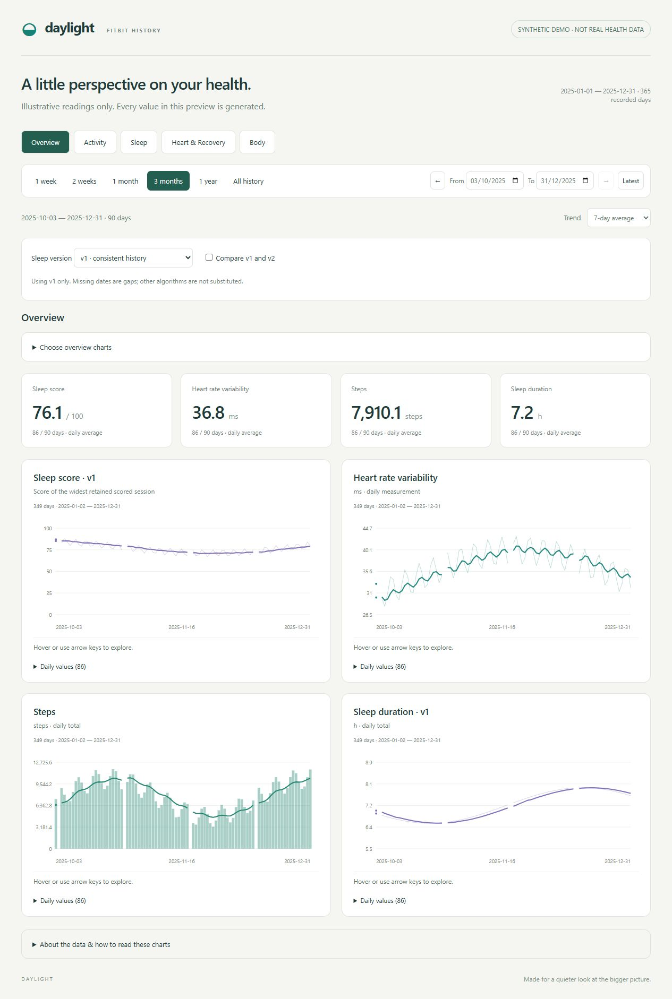

# Daylight

**A local dashboard for exploring your Fitbit and Google Health history.**

Daylight turns an extracted Takeout export into interactive charts for activity, sleep, heart and recovery measurements, and body trends. Its goal is to make long-term patterns easier to see while keeping your health data on your own computer.

No accounts, API keys, cloud uploads, analytics, or external chart services. Once the project and Node.js are installed, importing and viewing your data works offline.



To explore the demo without an export, run `node dashboard/demo.mjs` and open [http://127.0.0.1:4174](http://127.0.0.1:4174). The demo never reads your imported dataset.

## Features

- Category tabs: **Overview, Activity, Sleep, Heart & Recovery, and Body**.
- A grouped chart picker that remembers your Overview choices in this browser.
- 21 supported measurements, including steps, calories, sleep stages, oxygen, weight, and skin temperature.
- Exercise and sleep-session tables, with workout filtering by activity type.
- Ranges of 1 week, 2 weeks, 1 month, 3 months, 1 year, and all history.
- Custom dates for multi-year comparisons and previous/next period navigation.
- Daily readings with optional 7-day or 30-day smoothing.
- Coverage counts and visible gaps for missing observations.
- Interactive charts, keyboard inspection, and expandable daily-value tables.
- A reusable importer that preserves the original export files.

## Requirements

- Node.js 20 or newer, available as `node` in your terminal.
- A modern web browser.
- An extracted Google Health or Fitbit Takeout export with supported records.
- Git to clone the repository, or download and extract the repository ZIP instead.

No package installation or build step is required. Daylight uses built-in Node.js modules and plain HTML, CSS, and JavaScript.

## Quick start

### 1. Download the project

```sh
git clone https://github.com/promicroNL/daylight.git
cd daylight
```

If you downloaded the repository ZIP, extract it and open a terminal in the extracted project folder.

### 2. Prepare your export

Download your Google Health / Fitbit data through Google Takeout and extract the archive. Prefer keeping the export outside this repository. You can point the importer at the extracted Takeout root or its Google Health / Fitbit subfolder.

The importer reads folders, not ZIP files. If the export contains several archives, extract their contents into one folder while preserving the directory structure.

### 3. Import your data

From the project root, run the appropriate example with your own export path.

**Windows (PowerShell or Command Prompt):**

```powershell
node dashboard/import.mjs "C:\Users\YourName\Downloads\Takeout"
```

**macOS or Linux:**

```sh
node dashboard/import.mjs "/path/to/extracted/Takeout"
```

Quote paths, especially when they contain spaces. The importer prints parsed, empty, unsupported, and failed file counts, sample counts, measurement coverage, and parsing warnings. Unsupported files include account/security records and health formats outside this dashboard’s scope; they are not imported. Large heart-rate exports can take a little while to process.

The result is saved to `dashboard/data.json`. This file contains your private health summaries and is ignored by Git.

### 4. Start the dashboard

From the project root:

```sh
node dashboard/server.mjs
```

Open **[http://127.0.0.1:4173](http://127.0.0.1:4173)** in your browser. Keep the terminal running while using the dashboard; press `Ctrl+C` to stop it. Use this URL rather than opening `index.html` directly.

On Windows, after importing, you can also double-click **Start Dashboard.cmd**. If no generated data exists, the launcher first tries to import an export located under the project root. For exports stored elsewhere, run the explicit import command above first.

## Exploring your history

Import all supported health measurements once, then select what to view without importing again. The Overview starts with the original four sleep/heart charts. Open **Choose overview charts** to add or remove measurements; selections are saved locally for this browser and site address. Category tabs show all measurements in that category, with date coverage or an explicit unavailable message. Date ranges and smoothing stay the same when switching tabs.

Activity charts use daily bars. Sleep stages use stacked bars with a colour legend; these are unsmoothed, and missing stages are not inferred. Other measurements use lines. The Activity tab includes an exercise table with an activity-type filter. The Sleep tab includes individual sessions. All times retain their source calendar convention.

The dashboard initially shows the 90 days ending at the latest imported observation, which may be earlier than today.

| Control | Behavior |
| --- | --- |
| Range presets | Select 7, 14, 30, 90, or 365 days, or all history. Months and years use fixed day counts. |
| From / To | Choose a custom interval within your imported history. |
| Previous / next arrows | Move backward or forward by the selected interval. |
| Latest | Return to the latest observation using the active preset, or 90 days after a custom/all-history selection. |
| Trend | Select daily values, a 7-day mean, or a 30-day mean. |
| Chart inspection | Hover, or focus a chart with Tab and use arrow keys. Home and End jump to the endpoints. |
| Daily values | Expand the table below a chart for exact readings. |

Summary cards average the available daily values in the selected period and show the number of days with observations. Faint lines or bars show daily measurements; the stronger line shows the selected trend. Sleep-stage bars show the measured daily stage totals. Missing days remain gaps, including long gaps in all-history views.

## Importing new exports

Run the import command again with the new extracted export path, then refresh your browser. The server does not need to restart.

Each import **replaces** the generated dataset; it does not append to the previous import or modify the source export. To combine exports, put them beneath one input folder and import that folder. Repeated observations are deduplicated by source/timestamp or record ID. Newer Google records replace legacy values for the same metric and day. For sleep and exercise, an entire newer-source day takes precedence because migrated IDs and timestamps can differ. Prefer complete exports: a partial newer day can hide additional legacy records for that day.

An import with no supported observations preserves the previous dataset. If some recognized files cannot be parsed, the importer reports warnings and can still write the successfully parsed records. Review warnings for incomplete imports. Source files are not watched automatically.

## Supported export formats

| Category | Measurements and sources |
| --- | --- |
| Activity | Steps: `steps_*.csv` / `steps-*.json`; distance: `distance_*.csv` (metres → km); total calories: `calories_YYYY-*.csv` / `calories-*.json`; active calories: `active_energy_burned_*.csv`; weighted zone minutes: `active_zone_minutes_*.csv`. |
| Sleep | Scores: `sleep_score*.csv` / `UserSleepScores*.csv`; duration and awake time: `UserSleeps*.csv`; deep/light/REM stages: `UserSleepStages*.csv`. Legacy `sleep-*.json` provides session fallback. |
| Heart & Recovery | Heart samples: `heart_rate-*.json`; resting rate: `resting_heart_rate*.json`; HRV: `Daily Heart Rate Variability Summary*.csv`; readiness: `daily_readiness.csv`; stress: `Stress Score.csv`; oxygen: `Daily SpO2*.csv`; respiratory rate: `respiratory_rate_sleep_summary_*.csv` (milli breaths/min → breaths/min). |
| Body | Weight: `weight.csv` (grams → kg); skin temperature and exported-baseline deviation: `daily_sleep_temperature_derivations.csv` (°C). |
| Exercises | `UserExercises*.csv` with `exercise-*.json` fallback; duration, distance, calories and heart rate where supplied. Location metadata is excluded. |

Formats vary between exports. Unsupported filenames or schemas are not automatically converted. Missing metrics are shown as unavailable rather than estimated.

### Sleep version selection

Choose **v1**, **v2**, or **Hybrid** above the Overview or Sleep tab. The choice is saved in this browser. v1 is the default when available because it provides a consistent long-term series in the supplied export; v2 is selected by default only for exports without v1. Unversioned/legacy records can also be viewed separately.

- **v1 / v2:** only that version contributes to sleep duration, awake time, stages, and scores. Missing dates remain gaps.
- **Hybrid:** prefers v2, then v1, then unversioned records for overlapping sleep episodes. Non-overlapping naps remain included. A partial v2 record can replace a longer v1 night; the importer does not splice estimates together to fill it.
- **Compare v1 and v2:** shows separate duration bars, a mean duration difference for matched days only, and a table of duration, score and stage differences. The comparison always uses the same selected date range, regardless of the primary version choice.

Within one version, overlapping records retain the widest interval, with latest update breaking ties. The source documentation does not define the algorithms’ internal changes: v2 is not assumed to be medically more accurate. Changing methods can change a trend even when underlying sleep has not changed.

Possible duplicate workouts are flagged when the same activity type overlaps more than 80% of the shorter record. Both remain in the exercise table; this does not alter separately imported daily activity totals. Readiness component fields are not interpreted; some exported fields are constant or unspecified.

### How values are interpreted

- **Missing readings:** missing, non-finite, and source-specific invalid readings are excluded, including legacy zero placeholders for resting heart rate and failed stress calculations. Valid activity zeros and negative temperature deviations are preserved. Gaps are not interpolated.
- **Heart rate:** daily averages weight recorded samples equally, not time equally. Sampling density affects the result. Period summaries then weight available daily averages equally.
- **Resting heart rate:** only the dedicated daily source is charted. The resting-rate field attached to sleep scores is retained separately as `sleepRest` in generated data, but is not substituted into the chart.
- **Sleep scores:** newer Google `UserSleepScores` records take precedence over legacy records on the same date. When sessions are available, the score follows the widest retained scored session of the selected version. Score-only exports retain the latest update/timestamp in the preferred source. The dashboard shows one score per date.
- **Sleep sessions:** durations and stage minutes sum non-overlapping sessions ending on the same date, including naps. Some exports contain both v1 and v2 estimates of the same night with different IDs. Within the selected version, overlapping records retain the widest recorded time interval, then the latest update for equal durations. Hybrid first prioritizes the algorithm version. This is an explicit coverage heuristic, not a claim that one algorithm is medically more accurate. Excluded records can be inspected in the Sleep tab. Scores use the widest retained scored session when available. Stage information is joined by sleep ID. Missing stage types are left absent, not set to zero.
- **Activity:** total calories and active calories are separate measures, not additive. Active zone minutes retain the exported intensity weighting. A reported zero is not treated as a missing day. Calories can exist on days without recorded steps.
- **Body:** weight uses the final recorded value per day. Skin temperature is not core body temperature; deviation is calculated only when both the nightly temperature and exported baseline exist. No baseline is invented.
- **Legacy formats:** legacy distance and weight streams are not imported because units are not explicit in those records. Legacy exercise distance is used only when a supported explicit distance unit is present. ECG, glucose, menstrual records, account/security, commerce and social records are outside this version’s scope.
- **Dates:** the source timestamp's written calendar date is used. UTC timestamps remain UTC dates, and unzoned legacy timestamps are not converted. Day boundaries can differ from the Fitbit app.
- **Smoothing:** trailing averages use available observations within the selected calendar-day window, including days before the visible range. There is no minimum coverage threshold. A day without an observation remains a gap.

Daylight is a personal history viewer, not a diagnostic tool. It does not interpret changes as medical findings.

## Privacy

The server listens only on `127.0.0.1`, for access from the same computer. It serves the dashboard page, JavaScript modules, stylesheet, and generated dataset, not arbitrary export files. It has no authentication and is intended for local use, not public hosting.

Original export files are read only. There is no telemetry, CDN dependency, external font, or remote data service.

**Keep exports, generated datasets, and screenshots containing real readings out of public repositories.** The generated `dashboard/data.json` and temporary import file are ignored by Git. The root ignore rules cover `Google Health/`, `Fitbit/`, `Takeout/`, the archive index, and standard Takeout archive filenames, but not every possible custom folder name. Prefer storing exports outside the checkout and review staged files before publishing. Ignore rules do not remove previously committed files from Git history.

### Dataset compatibility

Existing four-metric `data.json` files remain readable. Reimport to generate schema version 3 with additional measurements, session summaries, per-metric coverage/source filenames, and independent sleep-version datasets. The dashboard does not require an automatic migration. Selecting charts changes only browser preferences, not the imported dataset.

## Troubleshooting

| Problem | What to check |
| --- | --- |
| `node` is not recognized | Install Node.js 20 or newer, reopen the terminal, and check `node --version`. |
| No supported health records found | Extract the archive and point the importer at a folder containing supported files. |
| Dashboard asks you to import | Complete an import before starting or refreshing the dashboard. |
| A chart has no observations | Try all history and check the dates under “About the data.” Your export may not contain that metric. |
| New data does not appear | Run the import command again, then refresh the browser. |
| Port 4173 is already in use | Stop the previous server or select another port. |

To use another port in PowerShell:

```powershell
$env:PORT = "4174"
node dashboard/server.mjs
```

Or in macOS/Linux shells:

```sh
PORT=4174 node dashboard/server.mjs
```

Then open [http://127.0.0.1:4174](http://127.0.0.1:4174).

## Development and validation

```text
dashboard/
  import.mjs    CSV/JSON discovery and daily aggregation
  server.mjs    Local HTTP server with an explicit asset allowlist
  index.html    Dashboard structure
  app.js        Category tabs, chart picker, charts, and session tables
  metrics.js    Shared metric definitions, units, and validation
  model.js      Dataset compatibility and chart calculations
  style.css     Responsive styling
  test.mjs      Parser and import checks
  data.json     Generated private dataset (ignored by Git)
```

From the project root:

```sh
node --test dashboard/test.mjs dashboard/features.test.mjs dashboard/real-export.test.mjs
node --check dashboard/app.js
node --check dashboard/server.mjs
```

The tests cover CSV parsing, source precedence, missing values, sample means, malformed files, and imported-data integrity. Real-data checks run when local data is available and expect no parsing warnings; they are skipped on a fresh clone. Synthetic tests require no private export. Representative real-export checks reconcile activity, sleep, temperature and exercise values against source records.

When reporting bugs or proposing another export format, provide the filename pattern and a small synthetic example with the same fields. Do not attach personal Takeout exports or real health records.
